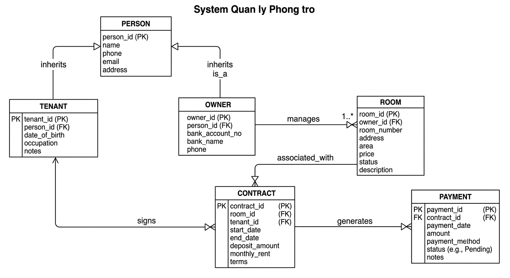

# HỆ THỐNG QUẢN LÝ PHÒNG TRỌ & CHO THUÊ

## 1. Sơ đồ Quan hệ Thực thể (ERD Diagram)



### Sơ đồ chi tiết (Mermaid ERD)

```mermaid
erDiagram
    PERSON ||--o| TENANT : "is"
    PERSON ||--o| OWNER : "is"
    
    OWNER ||--o{ ROOM : "manages"
    ROOM ||--o{ CONTRACT : "has"
    TENANT ||--o{ CONTRACT : "signs"
    
    CONTRACT ||--o{ PAYMENT : "generates"

    PERSON {
        bigint id PK
        string full_name
        string phone
        string email
    }

    TENANT {
        bigint id PK, FK
        string identity_card
        string occupation
    }

    OWNER {
        bigint id PK, FK
        string bank_account
    }

    ROOM {
        bigint id PK
        bigint owner_id FK
        string room_number
        decimal price
        string status
    }

    CONTRACT {
        bigint id PK
        bigint room_id FK
        bigint tenant_id FK
        date start_date
        date end_date
        decimal deposit
    }

    PAYMENT {
        bigint id PK
        bigint contract_id FK
        date payment_date
        decimal room_fee
        decimal electricity_fee
        decimal water_fee
        decimal total
    }